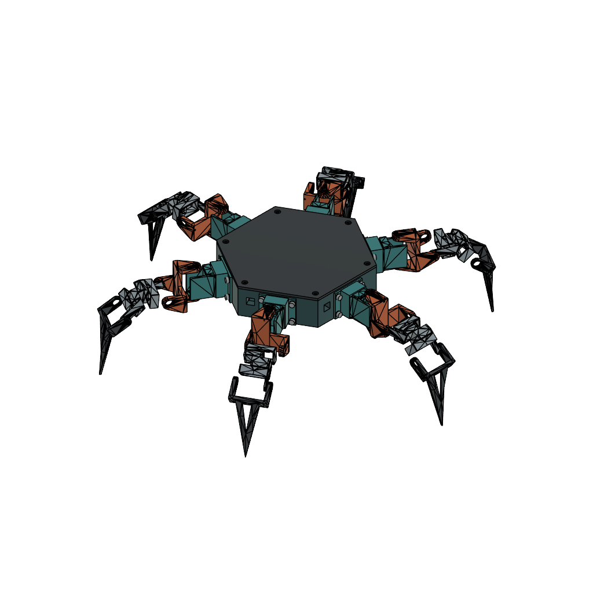

# CAD and selected print files

These are the seven STLs and two Fusion archives uploaded by the owner in commit [`dc7ff4e`](https://github.com/seunyboyxu/Spyder_Hexapod/commit/dc7ff4e). They are the selected print set for this repository. Their bytes are unchanged; selection does not establish mechanical fit or a completed powered robot.

The preview is the archive's own saved image, not a newly validated assembly or a photograph of the four-leg test build.

## Files and editable counterparts

| Printed part | STL | Fusion archive / named component | Intended quantity: four / six legs |
|---|---|---|---:|
| Chassis | [01_Chassis_x1.stl](print/stl/01_Chassis_x1.stl) | [Complete assembly](fusion/Spyder-complete-six-leg-assembly.f3d): `Chassis` | 1 / 1 |
| Plain lid | [02_Plain_lid_x1.stl](print/stl/02_Plain_lid_x1.stl) | Complete assembly: `Plain_editable_lid` | 1 / 1 |
| Fixed body mount | [Fixed-screw-mount-PRINT.stl](print/stl/Fixed-screw-mount-PRINT.stl) | Complete assembly: `Fixed_screw_mount` | 4 / 6 |
| Hip, v2 | [04_Hip_rear_pivot_v2_x6.stl](print/stl/04_Hip_rear_pivot_v2_x6.stl) | Complete assembly: `Hip_rear_pivot_v2` | 4 / 6 |
| Thigh | [05_Thigh_x6.stl](print/stl/05_Thigh_x6.stl) | Complete assembly: `Thigh-a` | 4 / 6 |
| Foot | [06_Foot_x6.stl](print/stl/06_Foot_x6.stl) | Complete assembly: `Foot-a` | 4 / 6 |
| Backing pivot | [Backing-pivot-original-PRINT.stl](print/stl/Backing-pivot-original-PRINT.stl) | **No matching editable source found in the uploaded archives.** Recovery path below. | 4 / 6 |

The quantities describe the structural design, not an inventory of fitted/printed parts. Names containing `x6` refer to the six-leg design; check the slicer plate and quantity before printing for the four-leg bench build.

The mapping is supported by names extracted from the native Fusion design stream and the original handover. Fusion was not run here and a mesh-to-solid/re-export geometry comparison was not performed. Use the assembly's v2 hip rather than assuming the earlier single-leg archive has the same revision.

The other native file, [Spyder-leg-fixed-screw-mount.f3d](fusion/Spyder-leg-fixed-screw-mount.f3d), contains the earlier fixed screw mount and original `Hips-a`, `Thigh-a` and `Foot-a` references. Its feature history retains some old dovetail labels; the active user decision is fixed screw mounts. Do not restore the abandoned detachable design from those historical features.

## Editing in Fusion 360

1. Download the repository or the `.f3d` using GitHub's raw/download button. GitHub's page is not the CAD file.
2. In Fusion, open the local `.f3d` through **File → Open → Open from my computer** (or upload it through the Data Panel).
3. Save a new working copy. Locate the named component/body in the browser, isolate it, and inspect its position and revision before editing. Repeated leg occurrences are not necessarily independent designs; deliberately choose whether a change should affect every instance.
4. The chassis and lid have editable solid counterparts. The original leg geometry includes faceted mesh-derived surfaces; a native Fusion archive does not guarantee a clean, fully parametric sketch history. Inspect whether the selected object is a mesh or BRep before choosing edits. Nominal servo references are not fitted manufacturer geometry.
5. Export edited parts as both native Fusion and STEP where possible, then re-export the selected STL in millimetres. Compare dimensions/orientation with the previous part and trial-fit one retained joint before duplicating it. Do not regenerate the full six-leg package from an earlier script without reviewing its revision.
6. Commit source and print export together. Update [parts.csv](parts.csv), [asset-manifest.json](asset-manifest.json), checksums and the change record with the new revision and what was physically checked.

No geometry conversion or new `.f3d` was fabricated during this organization.

## Missing backing-pivot source and fit revisions

The [original handover](../docs/archive/2026-10-16-SPYDER-CODEX-HANDOVER.md) identifies `models/Insert_body.stl` in [quadpod](../docs/reference/upstream.md) as the source family. The uploaded print is a grounded export with different bytes from the pinned upstream mesh; an exact-file match is not claimed.

The handover's prior output folder `SG90-missing-backing-pivot/` and `SG90-missing-backing-pivot.zip` reportedly contain an editable STEP, but neither was uploaded here. Recover that package from the original project machine/conversation, inspect the STEP against this print, then add it under `cad/step/` with provenance. The owner has since supplied a [Windows recovery folder](../docs/handover.md#recovery-folder-supplied-by-the-owner); its contents are not accessible from this cloud workspace until transferred. No standalone backing-pivot `.f3d` has been found. A mesh conversion would be a newly reconstructed source, not recovery of the original.

The complete assembly predates the later v3 fit trial. It does not incorporate a validated motor/horn/backing-pivot stack. V3's reported 0.50 mm backing plate consumes its 0.20 mm nominal ear clearance, leaving 0.30 mm interference; this concerns that v3 stack and is not a measured defect in every selected v2 part. The v3 fit packages, their CAD and the missing-pivot STEP still need recovery. Check the actual installed version before changing or printing parts.

## Provenance and integrity

- [parts.csv](parts.csv): machine-readable print-to-CAD map and intended quantities.
- [asset-manifest.json](asset-manifest.json): original filenames, exact source commit, bytes, SHA-256, triangle counts and export-axis extents.
- [SHA256SUMS](SHA256SUMS): run `sha256sum -c cad/SHA256SUMS` from the repository root.
- Only the malformed lid filename changed: `02_Plain_lid).stl` → `02_Plain_lid_x1.stl`. All seven meshes and both native files retain their original bytes.
- Both native archives were decompressed read-only and every member's length/CRC verified, including ZIP method 93/Zstandard members. Component-name inspection is not a Fusion editability or mechanical validation test.
- STL is unitless. The chassis measures approximately 136 × 157.039 × 31 export units and the lid 136 × 157.039 × 2.5, consistent with the handover's millimetres. Rotated part extents are not axis-to-axis kinematic lengths.

Print prototypes were specified as PLA on an Elegoo Neptune 3 Pro with a 0.4 mm nozzle. The handover gives a special backing-insert trial profile; there is no newly verified universal slicing profile for the full print set. See [upstream attribution](../docs/reference/upstream.md) before redistribution and [hardware checks](../docs/bring-up.md) before assembled motion.
